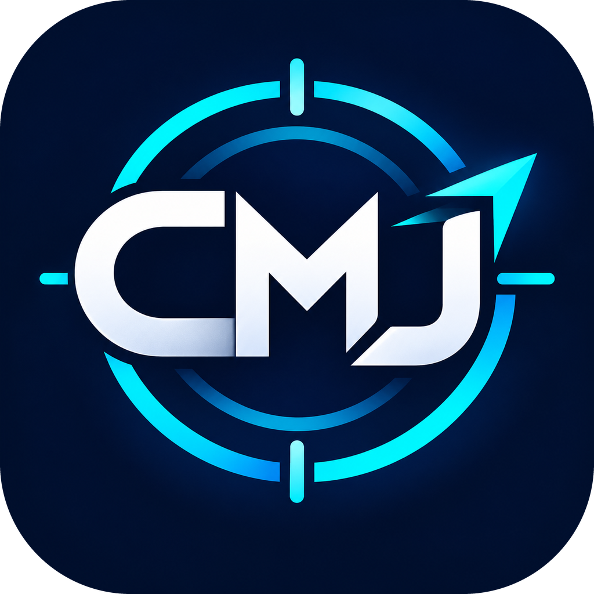

 <div align="center">

  

  <h1>Charlie MJ Focus</h1>

  <h3>Plan. Focus. Finish.</h3>

  <p>
    <strong>Your Personal Productivity Companion for Windows</strong>
  </p>

  <p>
    A modern productivity application combining Pomodoro focus sessions,
    smart task management, daily planning and productivity analytics.
  </p>

  <p>
    
  </p>

  <p>
    <a href="downloads/Charlie-MJ-Focus-Windows-Portable.zip">
      
    </a>
    &nbsp;
    <a href="downloads/Charlie-MJ-Focus-Windows-Installer.zip">
      
    </a>
  </p>

  <p>
    
    
    
    
    
  </p>

  <p>
    <a href="#features">Features</a> •
    <a href="#download">Download</a> •
    <a href="#screenshots">Screenshots</a> •
    <a href="#installation">Installation</a> •
    <a href="#architecture">Architecture</a> •
    <a href="#roadmap">Roadmap</a>
  </p>

</div>

---

## About the Project

**Charlie MJ Focus** is a Windows productivity and time-management application designed to help you organize your day, manage tasks, build consistent focus habits and understand how you spend your time.

It brings together a Pomodoro timer, time-based task management, daily planning, productivity statistics and Windows desktop integration in one application.

Whether you are studying, working, developing software, managing projects or building better daily habits, Charlie MJ Focus helps you stay organized and focused.

### Built around three principles

<div align="center">

| PLAN | FOCUS | FINISH |
|:---:|:---:|:---:|
| Organize your day and tasks. | Protect your attention and time. | Track progress and complete your goals. |

</div>

### Privacy-first productivity

- No account required.
- No mandatory internet connection.
- No tracking or advertising.
- Local SQLite database.
- Local backups and application data.
- Portable mode for USB-drive usage.

> **Current version:** `0.1.0`  
> **Application:** Windows Desktop  
> **Development status:** Active development

Automated unit tests and integration tests against a real SQLite database run through the GitHub Actions workflow. The project also includes an application launch test that starts the executable and captures application pages. See [Release Documentation](docs/RELEASES.md).

---

## Download

<div align="center">

  <h2>Get Charlie MJ Focus</h2>

  <p>Choose the Windows edition that works best for you.</p>

</div>

| Edition | Download | Description |
|---|---|---|
| **Portable Edition** | [Download Portable ZIP](downloads/Charlie-MJ-Focus-Windows-Portable.zip) | Run without installation. Suitable for USB drives and portable use. |
| **Windows Installer** | [Download Installer ZIP](downloads/Charlie-MJ-Focus-Windows-Installer.zip) | Contains the Windows setup executable, Start Menu shortcut and optional desktop shortcut. |

### Download buttons

<div align="center">

  <a href="downloads/Charlie-MJ-Focus-Windows-Portable.zip">
    
  </a>

  <br><br>

  <a href="downloads/Charlie-MJ-Focus-Windows-Installer.zip">
    
  </a>

</div>

### 1. Portable Edition

The portable edition is designed for users who want to run Charlie MJ Focus without installing it.

**Installation steps:**

1. Download `Charlie-MJ-Focus-Windows-Portable.zip`.
2. Extract the ZIP archive.
3. Open the extracted directory.
4. Run `Charlie-MJ-Focus.exe`.
5. Your application data is stored in the `Data` directory beside the executable when portable mode is enabled.

**Benefits:**
- No traditional installation required.
- Suitable for USB drives.
- Portable application data.
- No separate .NET installation required for the published self-contained build.

### 2. Windows Installer

The installer edition provides a conventional Windows installation experience.

**Installation steps:**

1. Download `Charlie-MJ-Focus-Windows-Installer.zip`.
2. Extract the ZIP archive.
3. Locate the included Setup executable.
4. Run the installer.
5. Follow the installation wizard.
6. Launch Charlie MJ Focus from the Start Menu or desktop shortcut.

**Benefits:**
- Windows installation wizard.
- Start Menu shortcut.
- Optional desktop shortcut.
- Standard uninstall support.
- Application data stored under `%LOCALAPPDATA%\CharlieMJFocus`.

> **Security notice:** The application downloads are currently not code-signed. Windows SmartScreen may display an unknown-publisher warning. Only run the application if you trust the downloaded package and its source. If Windows Security removes an executable, consult [Troubleshooting](docs/TROUBLESHOOTING.md).

### GitHub Actions artifacts and releases

You can also access generated builds through GitHub:

- **Actions:** Open the repository's Actions tab, select the latest successful `Build, test and package` workflow run and download its artifacts.
- **Releases:** Versioned releases can include the portable ZIP and installer executable.

Example release tagging:

```bash
git tag v0.1.0
git push origin v0.1.0
```

---

## Features

Charlie MJ Focus combines several productivity tools in one Windows application.

### Productivity dashboard

Your daily productivity overview.

- Today's focus time.
- Daily focus goal progress.
- Productivity streak.
- Upcoming tasks.
- Quick task creation.
- Overview of your daily progress.

### Pomodoro focus timer

A dedicated focus timer to help you work in structured sessions.

- Standard 25-minute focus session.
- 5-minute short break.
- 15-minute long break.
- Adjustable focus and break durations.
- Long break after four focus sessions.
- Start, pause, resume and reset controls.
- Skip break functionality.
- Automatic session-start options.
- Stopwatch mode.
- Visual progress ring.
- Distraction counter.
- Sound and desktop notifications.

### Reliable timer recovery

The timer uses actual clock time rather than relying on counting individual timer ticks.

- Saves active session state periodically.
- Recovers a running session after application restart or crash.
- Restores the recovered session in a paused state.
- Reduces timing inaccuracies caused by application delays.

### Smart task management

Create and manage tasks with scheduling information.

- Task titles and descriptions.
- Notes and categories.
- Priority levels.
- Due dates.
- Scheduled start and end times.
- Estimated focus sessions.
- Daily, weekday, weekly and monthly repetition.
- Reminders before scheduled start times.
- Task completion tracking.

### Task-to-timer integration

Connect your tasks directly with your focus sessions.

- Start a focus session from a task.
- Associate recorded focus time with the selected task.
- Track planned versus actual time.
- Understand how much time individual tasks require.

### Daily planner

Organize your day with a time-based planning system.

- 24-hour daily timeline.
- Schedule tasks by start and end time.
- Detect overlapping tasks.
- Display overlapping scheduled activities side by side.
- Find available free time slots.
- Move unfinished tasks to the current day.
- Compare planned and actual time.

### Productivity analytics

Understand your productivity through historical statistics.

Supported reporting periods:

- 7 days.
- 30 days.
- 90 days.
- 365 days.

Available statistics include:

- Total focus time.
- Break time.
- Completed focus sessions.
- Completed tasks.
- Average focus session.
- Best productivity day.
- Distraction count.
- Focus time by category.
- CSV export.

### Appearance and personalization

Customize the application to suit your desktop environment.

- Light theme.
- Dark theme.
- Follow Windows theme.
- Mica transparency.
- Acrylic transparency.
- Window opacity from 40% to 100%.
- Custom accent colors.
- Adjustable text size.
- Rounded or square window corners.
- Compact layout.
- Always-on-top window option.

**Transparency compatibility:**

Mica and Acrylic effects require Windows 11 version 22H2 or newer. On Windows 10, the application uses a solid window while retaining the supported opacity functionality.

### Windows desktop integration

Designed to work naturally with Windows.

- System tray integration.
- Floating always-on-top timer.
- Global keyboard shortcuts.
- Start with Windows option.
- Single-instance application behavior.
- Minimized startup support.

### Local data management

Your productivity data stays on your computer.

- SQLite database.
- Automatic daily backups.
- Manual backup support.
- Portable data storage.
- Application logs.
- CSV exports.
- Local database files.

---

## Feature Overview

| Feature | Description |
|---|---|
| Focus Timer | Structured Pomodoro sessions and stopwatch |
| Task Manager | Tasks, priorities, due dates and reminders |
| Daily Planner | Time-based scheduling and timeline |
| Dashboard | Daily progress, streaks and upcoming tasks |
| Analytics | Productivity statistics and CSV reports |
| Appearance | Themes, transparency and customization |
| Windows Integration | Tray, hotkeys and startup support |
| Data Storage | Local SQLite database and backups |
| Portable Mode | Run the application from removable storage |

---

## Keyboard Shortcuts

The following global shortcuts are available from other applications as well.

| Keyboard Shortcut | Function |
|---|---|
| `Ctrl + Alt + P` | Start or pause the focus timer |
| `Ctrl + Alt + D` | Count a distraction |

---

## Screenshots

Application screenshots and visual demonstrations can be added here as the project develops.

Suggested screenshot locations:

```text
assets/
├── CharlieMJFocus-Logo.png
├── Charlie MJ Focus Productivity Banner.png
└── screenshots/
    ├── dashboard.png
    ├── focus-timer.png
    ├── task-management.png
    ├── daily-planner.png
    ├── analytics.png
    └── appearance-settings.png
```

When the screenshots are available, you can display them using:

```html
<div align="center">
  
  <p><strong>Productivity Dashboard</strong></p>
</div>
```

---

## Installation

### System requirements

| Requirement | Supported configuration |
|---|---|
| Operating system | Windows 10 (1809) or Windows 11 |
| Architecture | 64-bit |
| Runtime | Self-contained published editions |
| Database | SQLite |
| Development framework | .NET 10 |
| IDE | Visual Studio 2022 17.14+ or Visual Studio 2026 |

You do not need Visual Studio or the .NET SDK to run the published Windows editions.

### Build from source

Clone the repository:

```powershell
git clone https://github.com/awsrmmustansarjavaid/CharlieMJFocus.git

cd CharlieMJFocus
```

Restore dependencies:

```powershell
dotnet restore CharlieMJFocus.sln
```

Build the application:

```powershell
dotnet build CharlieMJFocus.sln -c Release
```

Run the application:

```powershell
dotnet run --project src/CharlieMJFocus.App
```

Alternatively, open `CharlieMJFocus.sln` in Visual Studio, select `CharlieMJFocus.App` as the startup project and press F5.

### Run automated tests

```powershell
dotnet test CharlieMJFocus.sln
```

The test suite includes unit tests and integration tests using a real SQLite database.

### Generate Windows application packages

The project includes PowerShell publishing scripts.

**Build the portable edition:**

```powershell
./scripts/publish-portable.ps1
```

**Build the Windows installer:**

```powershell
./scripts/publish-installer.ps1
```

The installer build requires Inno Setup 6.

Generated packages are placed in:

```text
artifacts/
```

---

## Data Storage and Privacy

Charlie MJ Focus uses local storage to keep your productivity information on your computer.

### Data locations

| Application edition | Data location |
|---|---|
| Installed edition | `%LOCALAPPDATA%\CharlieMJFocus\` |
| Portable edition | `Data\` beside the executable |

### Application data structure

```text
CharlieMJFocus/
└── Data/
    ├── charliemjfocus.db
    ├── Backups/
    ├── Logs/
    └── Exports/
```

| File or directory | Purpose |
|---|---|
| `charliemjfocus.db` | Main SQLite database |
| `Backups/` | Automatic and manual backups |
| `Logs/` | Application log files |
| `Exports/` | Exported productivity data |

**Important:** Uninstalling the application does not delete the application data directory.

### Restore a database backup manually

1. Close Charlie MJ Focus.
2. Open the application's `Data` directory.
3. Open the `Backups` directory.
4. Select the backup you want to restore.
5. Copy it over `Data\charliemjfocus.db`.
6. Start the application again.

Keep a separate copy of your database before replacing it.

---

## Architecture

Charlie MJ Focus follows a layered architecture designed to separate business logic, application use cases, infrastructure and presentation.

```text
                    Charlie MJ Focus
                           |
                           v
                  CharlieMJFocus.App
                      (WPF Shell)
                           |
                           v
                CharlieMJFocus.Presentation
                   (ViewModels and UI)
                           |
                           v
                CharlieMJFocus.Application
                  (Application Use Cases)
                           |
                           v
                  CharlieMJFocus.Domain
                    (Business Rules)


                CharlieMJFocus.Infrastructure
                           |
                           v
                Application + Domain
```

### Architecture layers

| Layer | Responsibility |
|---|---|
| Domain | Business entities, timer engine, scheduling and core rules |
| Application | Tasks, focus sessions, planner, statistics and export use cases |
| Infrastructure | SQLite persistence, backups, logging and file export |
| Presentation | ViewModels and presentation logic |
| App | WPF interface, themes, system tray, hotkeys and Windows integration |

### Dependency principles

Dependencies point inward:

```text
App → Presentation → Application → Domain

Infrastructure → Application → Domain
```

The Domain layer remains independent of the Windows interface and infrastructure implementation.

For more information, see [Architecture Documentation](docs/ARCHITECTURE.md).

---

## Project Structure

```text
CharlieMJFocus/
│
├── src/
│   ├── CharlieMJFocus.Domain/
│   │   └── Business rules, entities and timer engine
│   │
│   ├── CharlieMJFocus.Application/
│   │   └── Tasks, sessions, planner and statistics
│   │
│   ├── CharlieMJFocus.Infrastructure/
│   │   └── SQLite, backups, logging and exports
│   │
│   ├── CharlieMJFocus.Presentation/
│   │   └── ViewModels and presentation logic
│   │
│   └── CharlieMJFocus.App/
│       └── WPF application and Windows integration
│
├── tests/
│   └── CharlieMJFocus.Tests/
│
├── assets/
│   ├── CharlieMJFocus-Logo.png
│   ├── Charlie MJ Focus Productivity Banner.png
│   └── screenshots/
│
├── docs/
│   ├── ARCHITECTURE.md
│   ├── BRANDING.md
│   ├── DATABASE.md
│   ├── FEATURES.md
│   ├── RELEASES.md
│   └── TROUBLESHOOTING.md
│
├── downloads/
│   ├── Charlie-MJ-Focus-Windows-Portable.zip
│   └── Charlie-MJ-Focus-Windows-Installer.zip
│
├── scripts/
│   ├── publish-portable.ps1
│   ├── publish-installer.ps1
│   └── build and maintenance scripts
│
├── installer/
│   └── Inno Setup configuration
│
├── .github/
│   └── workflows/
│
├── CharlieMJFocus.sln
├── LICENSE
└── README.md
```

---

## Command-Line Options

Charlie MJ Focus supports command-line arguments for demonstrations, startup configuration and testing.

| Argument | Description |
|---|---|
| `--minimized` | Start minimized in the system tray |
| `--demo` | Populate an empty database with sample tasks and two weeks of history |
| `--page=Dashboard` | Open the Dashboard |
| `--page=Timer` | Open the Timer |
| `--page=Tasks` | Open Tasks |
| `--page=Planner` | Open Planner |
| `--page=Statistics` | Open Statistics |
| `--page=Appearance` | Open Appearance settings |
| `--page=Settings` | Open Settings |
| `--theme=Dark` | Apply the Dark theme |
| `--theme=Light` | Apply the Light theme |
| `--backdrop=Mica` | Enable Mica backdrop |
| `--backdrop=Acrylic` | Enable Acrylic backdrop |
| `--backdrop=None` | Disable transparency effects |

Available theme values include `System`, `Light` and `Dark`.

---

## Roadmap

Charlie MJ Focus is actively evolving. The following items are planned enhancements and should not be considered implemented features yet.

| Planned feature | Description |
|---|---|
| Projects and Subtasks | Organize tasks into projects and smaller activities |
| Weekly Planner | Weekly and monthly planning views |
| Drag-and-Drop Scheduling | Visually move tasks across the planner |
| PDF Reports | Generate printable productivity reports |
| Focus Heatmap | Visualize productivity patterns |
| Ambient Sounds | Background audio for focus sessions |
| Focus Profiles | Configurable focus environments |
| App and Website Blocking | Optional distraction-management controls |
| Restore from Backup | Restore backups from within the application |
| Customizable Hotkeys | Configure keyboard shortcuts |
| Full-Screen Focus Mode | Immersive distraction-free workspace |
| Optional Cloud Sync | Optional synchronization between devices |

See [Feature Status Documentation](docs/FEATURES.md) for the detailed implementation status.

---

## Documentation

Explore the project's documentation:

| Document | Description |
|---|---|
| [Architecture](docs/ARCHITECTURE.md) | Application architecture and design |
| [Branding](docs/BRANDING.md) | Logo, visual identity and branding |
| [Database](docs/DATABASE.md) | Database structure and persistence |
| [Features](docs/FEATURES.md) | Feature descriptions and implementation status |
| [Releases](docs/RELEASES.md) | Build and release process |
| [Troubleshooting](docs/TROUBLESHOOTING.md) | Common installation and runtime issues |

---

## Automated Testing and CI/CD

The repository uses GitHub Actions to automate development and release-related checks.

The project workflow includes:

- Source checkout.
- .NET SDK setup.
- Dependency restoration.
- Release configuration build.
- Automated test execution.
- Application launch testing.
- UI screenshot capture.
- Portable Windows package generation.
- Windows installer generation.
- Artifact publishing.

Generated workflow artifacts can be accessed from the repository's **Actions** tab.

---

## Technology Stack

| Technology | Purpose |
|---|---|
| C# | Primary programming language |
| .NET 10 | Application framework |
| WPF | Windows desktop interface |
| SQLite | Local database |
| Entity/data access components | Database integration |
| PowerShell | Build and publishing automation |
| Inno Setup 6 | Windows installer generation |
| GitHub Actions | CI/CD automation |
| xUnit | Automated testing |

---

## Contributing

Contributions, bug reports, suggestions and improvements are welcome.

### Contribution workflow

1. Fork the repository.
2. Create a feature branch.
3. Implement your changes.
4. Add or update automated tests.
5. Run the test suite.
6. Submit a pull request.

Example:

```bash
git clone https://github.com/awsrmmustansarjavaid/CharlieMJFocus.git

cd CharlieMJFocus

git checkout -b feature/your-feature-name
```

Before submitting a pull request, verify the application builds successfully and the automated tests pass.

---

## License

Charlie MJ Focus is distributed under the **MIT License**.

See the [LICENSE](LICENSE) file for complete license information.

---

## Project Information

<div align="center">

  <h2>Charlie MJ Focus</h2>

  <h3>Plan. Focus. Finish.</h3>

  <p>
    Organize your time. Protect your focus. Achieve more.
  </p>

  <p>
    <a href="https://github.com/awsrmmustansarjavaid/CharlieMJFocus">
      
    </a>
  </p>

  <p>
    <a href="downloads/Charlie-MJ-Focus-Windows-Portable.zip">Portable Edition</a>
    &nbsp; • &nbsp;
    <a href="downloads/Charlie-MJ-Focus-Windows-Installer.zip">Windows Installer</a>
    &nbsp; • &nbsp;
    <a href="docs/FEATURES.md">Feature Status</a>
  </p>

  <p><strong>Focus More. Achieve More.</strong></p>

</div>